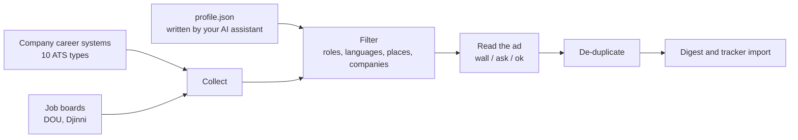

# Job Search Engine (JSE)

A daily job-search pipeline for any role and market. It collects new postings from company career systems and job boards, filters out the ones that do not fit **your** profile, reads the ad text for hidden blockers, removes duplicates and emails you a short digest. I built it for my own search as a delivery manager; it is now driven by a search profile, so the same engine works for a Python developer in Warsaw as well as for a project manager in Sofia.

**License.** Source-available under the [PolyForm Noncommercial License 1.0.0](LICENSE). It is free to use for personal and other noncommercial purposes, **including running your own job search**. Using it to earn money, for example inside a recruiting or coaching business or in a paid service, needs a separate licence from the author. It is not open source in the OSI sense.

I approached it the way I run delivery: start from the real process, automate the repetitive parts, keep a human in the loop for decisions, and measure whether each source is worth keeping.

Try the interactive demo of the tracker and a step-by-step setup guide: <https://mykola.pages.dev/tools/job-search-engine/>.

## How it works



| Step | Module | What happens |
|---|---|---|
| **1. Collect** | `poll_jobs.py`, `ats_fetch.py`, `boards.py` | Pulls *all* postings from 10 ATS types (Greenhouse, Lever, Ashby, SmartRecruiters, Workable, Recruitee, Breezy HR, Workday, Amazon, Remote.com) and from the job boards named in your profile |
| **2. Filter** | `job_filters.py`, `location_rules.py`, `priorities.py` | Keeps titles that match your roles, drops languages you do not speak, off-scope words and excluded companies, and gives every kept job a location priority P1 to P3 |
| **3. Read the ad** | `jd_fetch.py`, `jd_screen.py`, `jd_rules.py` | Downloads the ad text and flags blockers (residency, required languages, certificates, domains, office) as **wall / ask / ok**, judged against your profile |
| **4. De-duplicate** | `dedupe.py`, `collapse.py` | Matches by URL, board job id, and company plus similar role against your tracker; one requisition published once per country becomes one row |
| **5. Report** | `poll_jobs.py` | Writes `out/latest.md` and `out/import_latest.json` and emails a digest with only the postings you have not seen |

Optional: `replies.py` reads employer replies from your inbox (read-only) and `signals.py` follows funding news as leads. Both are off by default (`features` in the profile).

More detail: [docs/ARCHITECTURE.md](docs/ARCHITECTURE.md).

## Quick start

```bash
git clone https://github.com/hanizex/job-search-automation.git
cd job-search-automation
pip3 install -r requirements.txt

# 1. See it work with invented postings, no network and no accounts
python3 demo_offline.py --profile profiles/example_pl_python_dev.json
python3 demo_offline.py --profile profiles/example_eu_remote_pm.json

# 2. Make your own profile (your AI assistant interviews you and writes profile.json)
#    or start from an example:
cp profiles/example_pl_python_dev.json profile.json

# 3. Run it on real postings, without writing anything or sending email
python3 poll_jobs.py --dry-run --no-notify
```

Useful flags for `poll_jobs.py`:

```
--profile PATH    use this profile (default: $JSE_PROFILE, then ./profile.json)
--dry-run         fetch and filter, but write nothing and send no email
--no-notify       skip the macOS notification
--only NAME       fetch only this company (repeatable); forces --dry-run and skips the boards
--report-all      write the full current filtered set to out/all_current.md
--test-email      email the current out/latest.md without fetching
```

Run it daily with `launchd`, `cron` or any scheduler.

## Your profile

The engine has no built-in preferences. One JSON file says what a good job means for you: roles, languages you speak, where you live, where you could move, what you never want, certificates and industries you already have, and where to look. **You do not edit it by hand.** Your AI assistant interviews you and writes it; you only confirm. The prompt, the fields and two examples are in [profiles/README.md](profiles/README.md).

If the file is missing or wrong, the engine says what is missing in plain words.

## Where it looks

- **Company career systems** from `data/companies.json` (an example with 9 companies across different ATS types is included). Build your own list with `discover_ats.py`.
- **Job boards** named in `sources.boards`: **DOU** and **Djinni** by default. The searches are derived from your job titles ([catalog/sources.json](catalog/sources.json)), or you list them yourself. DOU accepts any search term; Djinni accepts only its own keywords, and an unknown one is rejected because it would silently return unfiltered jobs.
- More boards and sources are added when an efficient universal scan exists. A few author-specific ones (DEV.BG, iGaming sites, e-mail alerts) are in the code but off by default.

## Design decisions

- **APIs first, no scraping where an API exists.** Greenhouse, Lever, Ashby, SmartRecruiters, Workable, Recruitee, Breezy HR, Workday, Amazon and Remote.com expose public job endpoints. Boards are read slowly (3 seconds between requests to the same board), the same pages a person sees, and each page is read once per run.
- **Pagination is a trap, so it is handled explicitly.** SmartRecruiters silently caps pages at 100, Workday caps `limit` at 20 and *wraps around* after 2,000 results. `ats_fetch.py` paginates to the real end, retries a repeated page and de-duplicates by posting id.
- **Rules, not AI, for screening.** Filters and ad screening are plain, explainable rules. Every skip carries a reason, so wrong skips are easy to spot and fix.
- **Read once, judge many.** `jd_screen.extract_signals` reads an ad once; `jd_screen.match` judges it for one profile. That is cheap enough to serve many people from one reading.
- **Read-only and safe by default.** Email access never moves, deletes or marks messages. `--dry-run` writes nothing. A failure in one source never stops the daily run.
- **No credentials in code.** Secrets live in `.env`, which is git-ignored.
- **Minimal dependencies.** Python 3.9+, standard library plus `requests`.

## Email digest (optional)

Copy `.env.example` to `.env` and fill in a Gmail address and a Google **App Password**, not your normal password. Without `.env`, `poll_jobs.py` still writes `out/latest.md` but stops at the email step when there are new postings. `--dry-run` works without it.

## Tests

```bash
python3 test_jd_screen.py       # 54 ad-screening cases
python3 test_priorities.py      # location priorities
python3 test_url_hints.py       # URL hints
python3 test_patch.py           # tech-giant adapters, collapse, location rules
python3 test_workday_retry.py   # Workday repeat-page retry
python3 test_profile.py         # profile validation, other people's profiles
python3 test_screen_profiles.py # one ad judged for different people
python3 test_sources.py         # board searches and offline fetch of saved pages
python3 test_demo.py            # offline demo and the checked-in sample digests
```

All tests run offline, with the standard library only.

## Privacy

Your profile, tracker data, results, logs and saved pages stay in `data/` and `out/` on your machine and are git-ignored. The only network traffic is fetching public job pages and, if you set it up, sending your own digest through your own mail account.

## Limits

- The ad screening is regex rules in English plus Polish, German, Ukrainian and Russian phrases; an ad it cannot read is marked "nojd" and left to you.
- The geography catalogue (`geo/places.json`) covers 78 countries. A place it does not know is treated as needing a visa (P3), never silently dropped.
- Job boards have their own terms of service. Read them before you run this against a board; the defaults keep the request rate low.

## License and contributions

This project is licensed under the [PolyForm Noncommercial License 1.0.0](LICENSE) (<https://polyformproject.org/licenses/noncommercial/1.0.0>).

- **Allowed, free:** personal use, including running your own job search; research, study and hobby projects; use by charities, schools and public bodies; changing the code and sharing copies under the same terms.
- **Needs a separate licence:** any commercial use, for example using it in a business that sells recruiting or career services, or inside a paid product or hosted service. Ask the author through the GitHub profile below.
- I do not accept code contributions. Bug reports and ideas are welcome as issues.

---

Built by [Mykola Kalakutskyi](https://github.com/hanizex): Senior Delivery Manager. [LinkedIn](https://linkedin.com/in/hanizex)
