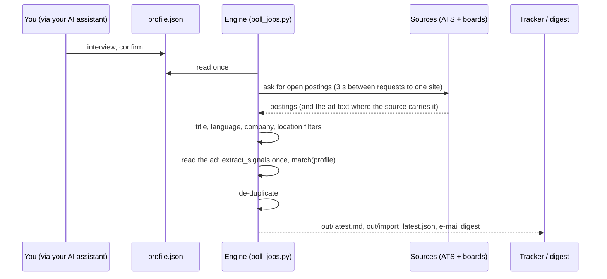

# Architecture

## The daily run

## Modules

| Area | Files |
|---|---|
| Profile and catalogues | `search_profile.py`, `geo.py`, `geo/places.json`, `sources.py`, `catalog/sources.json`, `i18n.py` |
| Collecting | `poll_jobs.py`, `ats.py`, `ats_fetch.py`, `boards.py`, `discover_ats.py`, `discover_careers.py` |
| Filtering | `job_filters.py`, `location_rules.py`, `priorities.py`, `url_hints.py` |
| Reading the ad | `jd_fetch.py`, `jd_screen.py`, `jd_rules.py` |
| De-duplication | `dedupe.py`, `collapse.py` |
| Optional | `replies.py`, `signals.py`, `suggest_companies.py` |
| Demo and tests | `demo_offline.py`, `fixtures/`, `test_*.py`, `testsupport.py` |

## Location priority

Each kept job gets one of three levels from your profile:

| Level | Meaning |
|---|---|
| P1 | home (on-site or hybrid), or fully remote and open to your region |
| P2 | a relocation zone you listed |
| P3 | needs a visa, or the place is in none of your zones. Hidden unless `location.show_p3` |

Excluded places are dropped. A row with several places keeps its best level, and is dropped only when every place is excluded. Remote jobs scoped to another region ("Remote - APAC") are not P1.

## Ad screening: read once, judge many

1. `jd_screen.extract_signals(text)` reads an ad and records what it demands. It does not depend on who is applying.
2. `jd_screen.match(extracted, profile)` judges those demands for one person: a residency in your own country, a language you speak, a certificate or industry you hold, EU citizenship you have, an office in your own city are not blockers for you.

A shared service can therefore read each ad once and judge it for many people.

## Job boards

- **DOU:** `https://jobs.dou.ua/vacancies/feeds/?category=<term>`. Any search term works. A feed carries the latest 25 vacancies and their text.
- **Djinni:** `https://djinni.co/jobs/?primary_keyword=<keyword>`. Only its own keywords filter the list; an unknown keyword returns unfiltered jobs, so the profile validator rejects it.

`catalog/sources.json` records what was checked and when.
